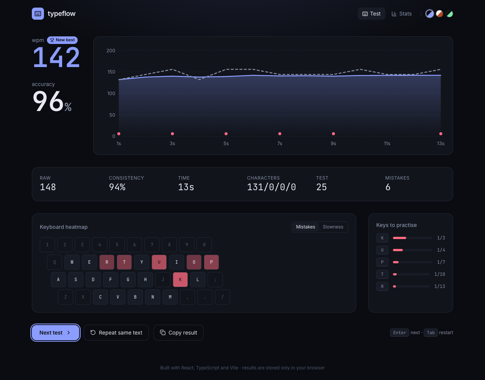
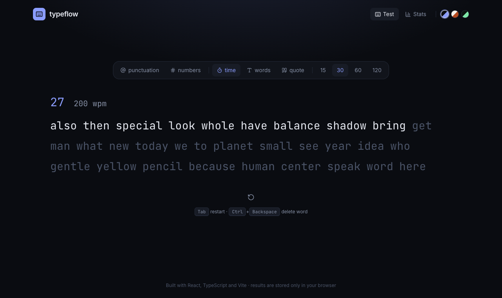
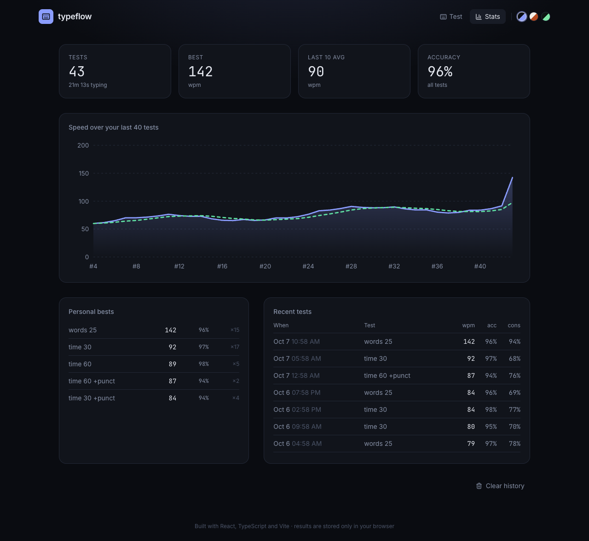
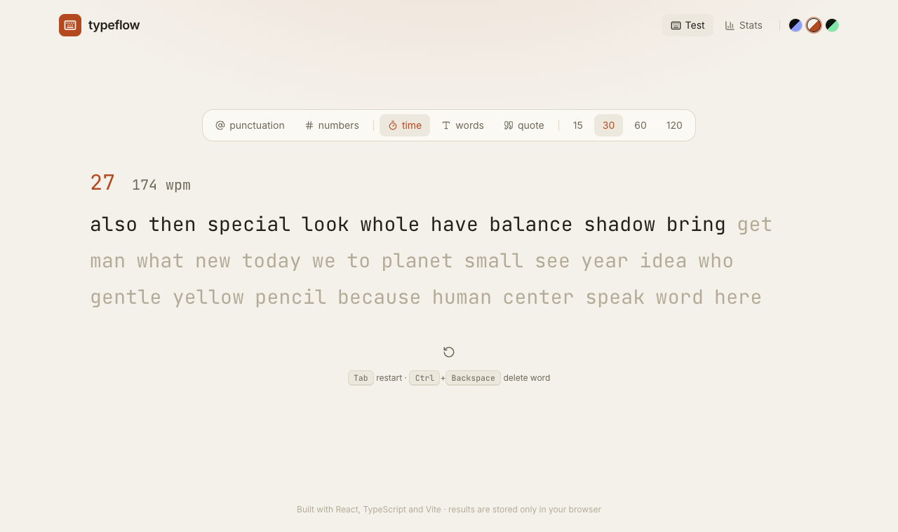
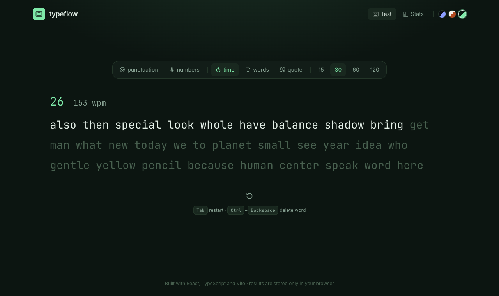

# typeflow

A fast, clean typing speed test. Live WPM, accuracy, consistency, a per-key heatmap of where you slow down or slip, and a history that tracks your progress. Everything runs in the browser and nothing leaves your machine.

**[Try it live →](https://duelboy03.github.io/typeflow/)**



<table>
<tr>
<td></td>
<td></td>
</tr>
<tr>
<td></td>
<td></td>
</tr>
</table>

## Features

- **Three modes:** timed (15/30/60/120 s), word count (10/25/50/100) and quotes (short, medium, long), with optional punctuation and numbers.
- **Honest metrics:** net WPM uses the standard five-characters-per-word convention and only counts correct words, so a mistyped word does not help your score. Raw WPM, accuracy (corrections still count against you), and consistency are reported alongside it.
- **Per-second chart** of WPM and raw speed with mistakes marked on the baseline, and a hover tooltip.
- **Keyboard heatmap:** which keys you miss, and which keys you reach slowest.
- **Progress tracking:** personal bests per setup, a rolling average, a history chart and a recent-tests table, stored in `localStorage`.
- **Three themes** (Midnight, Paper, Matcha), reduced-motion support, keyboard-first controls and a layout that holds up on phones.
- **Reproducible tests:** word lists come from a seeded PRNG, so "Repeat same text" replays the exact text.

## How it works

The test logic is a pure reducer with no React or DOM in it, which is what makes it testable.

```
src/engine/   pure TypeScript: session reducer, metrics, word generation, quotes
src/hooks/    useTypingTest: wires the reducer to a clock and the keyboard
src/components/   TypingArea, Results, LineChart (hand-written SVG), KeyboardHeatmap, StatsPage
src/lib/      localStorage persistence (guarded for private mode) and history statistics
```

A few details worth knowing:

- **Input goes through one hidden `<input>`** rather than window key listeners, so IME and mobile keyboards work and the browser handles focus.
- **The caret and line scrolling are measured from real layout** (`offsetLeft`/`offsetTop` of the active letter), so wrapping at any width stays correct without hard-coded character widths.
- **The clock lives outside the reducer.** The hook ticks every 100 ms and passes elapsed time in, so the reducer stays deterministic and every behaviour can be tested with plain numbers.
- **Chart samples are taken inside the reducer** at each whole second, from the same state the final score is computed from, so the graph always agrees with the number on screen.
- **Consistency** uses the coefficient of variation of per-second raw speed passed through a `tanh` curve, so ordinary human variation lands in the 60–80 range instead of collapsing to zero.

## Getting started

```bash
npm install
npm run dev          # http://localhost:5173
```

| Command | What it does |
| --- | --- |
| `npm test` | Unit tests (Vitest) |
| `npm run coverage` | Unit tests with coverage |
| `npm run test:e2e` | End-to-end tests (Playwright, uses installed Chrome) |
| `npm run typecheck` | `tsc -b` |
| `npm run lint` | oxlint |
| `npm run build` | Production build |

## Testing

- **29 unit tests** cover the reducer (starting, overflow cap, backspace rules, finishing on the last word and on the time limit), WPM, accuracy, consistency, per-key stats, seeded word generation, storage corruption handling and statistics.
- **7 end-to-end tests** drive a real browser: complete a test, introduce mistakes, backspace, restart with Tab, persistence across reloads, theme persistence and a timed test ending on its own.
- CI runs lint, typecheck, coverage, build and the end-to-end suite on every push, and the `main` branch deploys to GitHub Pages.

## Stack

React 19 · TypeScript · Vite · Tailwind CSS 4 · Vitest · Playwright · GitHub Actions

## License

MIT
